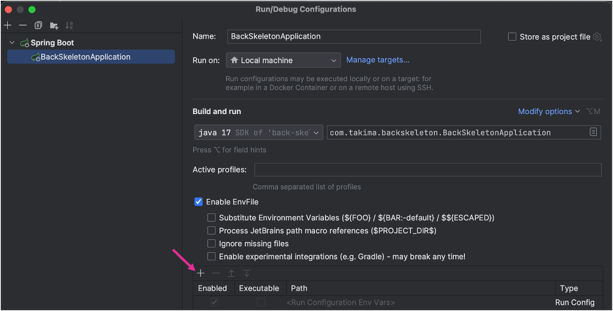
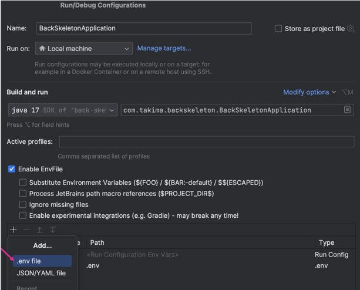

# Your backend API

## Set up 
1. Copie-colle le `.env.sample` en `.env`
2. Remplis le fichier `.env` avec les credentials de ton choix
3. Fait un `docker compose up`
4. Rajoute le plugin : [env-file](https://plugins.jetbrains.com/plugin/7861-envfile)
5. Ajoute ton fichier `.env` comme ci-dessous (n'oublie pas d'activer les fichiers cachés)

## Configuration d'exécution
- `SWAGGER_ENABLED` : `true` active `/swagger-ui/index.html` et `/v3/api-docs` (défaut `false` ; `npm run back` côté front l'active en local).
- Profil `prod` (`SPRING_PROFILES_ACTIVE=prod`) : `CORS_ALLOWED_ORIGINS` est obligatoire (origines séparées par des virgules, ni vide ni `*`), sinon l'API refuse de démarrer.
- `POST /games` est limité par IP (défaut 20 créations par minute, réponse `429`) : `game.creation.rate-limit.max-requests` et `game.creation.rate-limit.window` (durée ISO-8601, ex. `PT1M`).
- Les parties sans aucun pick sont purgées après 15 min d'inactivité, les autres après 2 h.
- En `prod`, l'API doit être derrière un reverse proxy dont l'IP est interne (10/8, 172.16/12, 192.168/16, 127/8) : l'IP cliente est lue dans `X-Forwarded-For` (`server.forward-headers-strategy=native`). Sinon, ajuster `server.tomcat.remoteip.internal-proxies`.
- `GET /seasons`, `/teams` et `/formations` sont servis avec `Cache-Control: public` (réponses 2xx uniquement) et un ETag faible ; durée : `catalog.cache.max-age` (défaut `PT1H`). La compression HTTP est active.
- Base de données : `postgres:16-alpine` avec un `healthcheck`. Si un ancien conteneur PostgreSQL d'une autre version existe, lancer `docker compose down -v` puis `docker compose up -d` : la base est rechargée depuis `initdb/`.
- Couverture : `./mvnw verify` génère le rapport JaCoCo dans `target/site/jacoco/index.html` (sans seuil bloquant). La CI échoue si Docker est absent ou si un test est ignoré.
